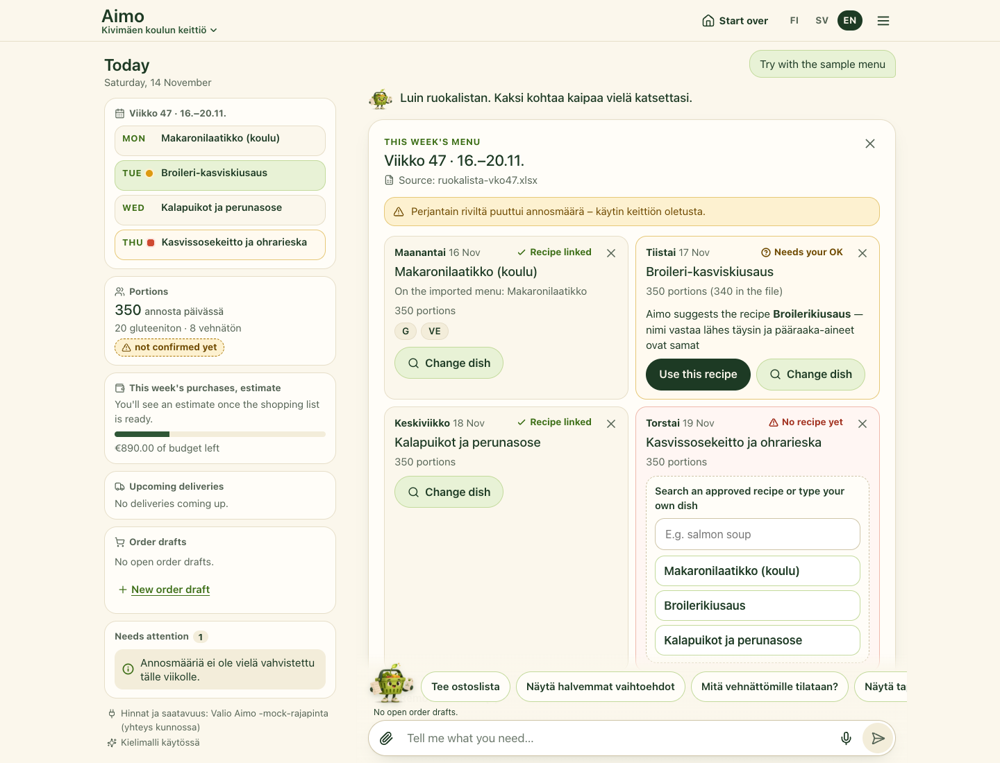
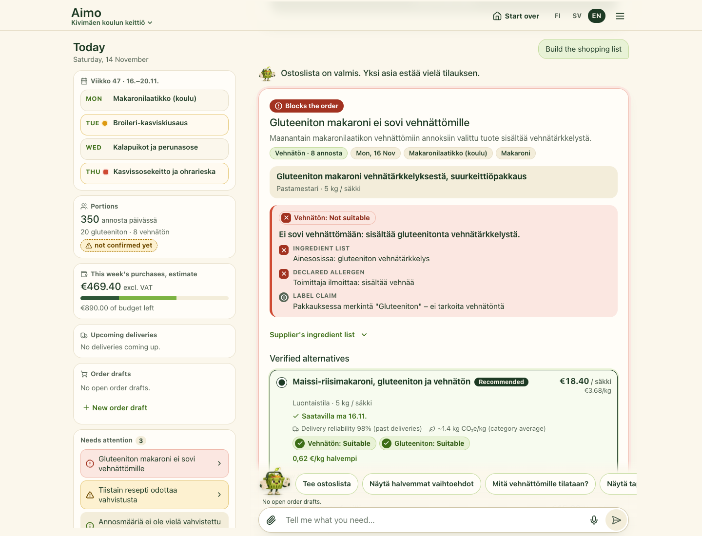

# Aimo — a purchasing assistant for professional kitchens

Built for the Junction 2026 Valio Aimo challenge, "Trusted Trade Agents".

**[Try the demo](https://aimo.aichat.fi)** · [Agent interface](docs/agent-interface.md) · [Run locally](#run-locally)


*The kitchen reviews a weekly menu and its recipe matches.*

Screenshots show the local UI demo with synthetic data, not live supplier responses.

Aimo does two things:

1. **For a school kitchen:** it turns next week's lunch menu (Excel, PDF or typed text) into a verified,
   ready-to-approve wholesale order. It links dishes to the kitchen's approved recipes, scales them to the
   portion counts of each diet group, deducts known stock, rounds to real pack sizes, fetches live price
   and availability, and checks every special-diet product against supplier data before a human signs off.
2. **For external purchasing agents:** it exposes the same catalog, checks, rules and order flow through an
   open [MCP](https://modelcontextprotocol.io) interface. An agent can search, get a fixed-price quote and
   order inside the authority it was granted. Anything beyond that goes to a human in the Aimo UI. Each
   registered agent has its own token, account and limits, and every quote and order confirmation is signed
   by the server, so the agent can verify it without a person checking by hand.

The language model interprets requests, picks a tool and can suggest an unapproved ingredient starting
list for the buyer to check. Allergen verdicts, order quantities, prices, authority and approvals are
decided by deterministic rules.

- Agent interface reference: [`docs/agent-interface.md`](docs/agent-interface.md) (also served at `/docs/`)
- API contract between server and UI: [`shared/types.ts`](shared/types.ts)

## Two-minute demo

The figures below are from a run on 14 Nov 2026. Prices and availability come live from the mock API, so
totals can differ.

**Part 1 — the kitchen (UI)**

1. Upload `demo/ruokalista-vko47.xlsx` (or the `.pdf`, or use the "Use the sample menu" suggestion).
   Aimo reads five days. Four dishes match approved recipes by exact name. Friday's "Kalakeitto" (fish
   soup) does not, so Aimo proposes "Lohikeitto" (salmon soup) and asks instead of guessing. Confirm it.
2. Say: *"We have 350 lunches per day, including 20 gluten-free and 8 wheat-free."*
   Aimo records 322 standard, 20 gluten-free and 8 wheat-free portions and builds the shopping list.
3. Aimo stops three products for the wheat-free group and explains why with supplier evidence:
   - **Sunnuntai dark gluten-free flour mix** and **Fria gluten-free white bread**: both carry a
     gluten-free claim, and both list gluten-free wheat starch as an ingredient. Fine for the gluten-free
     group, not allowed for the wheat-free group.
   - **Knorr vegetable bouillon** (the stock): the supplier data has no allergen declaration, so the
     wheat-free verdict is `unknown`. It is not used until verified.
4. Each issue offers up to three verified alternatives: supplier-declared substitutes first, then products
   from the same category, then by what the needed amount would cost. The tier is shown on each card.
   Accept one per issue. Aimo re-verifies it
   and remembers the choice for next time.
5. Create the order (23 lines, about EUR 4,045 excl. VAT). It waits for approval because the total is
   above the kitchen user's EUR 1,500 limit and some order cutoffs in the mock data have passed.
6. Approve. Aimo re-checks price, availability and allergens, then records the order with a `SIM-…`
   confirmation. Submission is a local simulation and is labelled as such everywhere.

**Part 2 — an external agent (MCP)**

7. An agent calls `prepare_order` for 1,000 L of lactose-free milk for Monday and gets a fixed-price
   quote (EUR 1,010 in our run), with ranked options and the reasons it cannot place the order itself.
8. The agent calls `place_order` anyway and gets `approval_required`: EUR 1,010 is above its EUR 500
   authority. The attempt is written to the audit log.
9. The agent calls `request_approval`. The order shows up in the Aimo UI as waiting for approval, with the
   agent's name and its note.
10. The human approves in the UI. The agent polls `get_order_status` and sees `submitted` with the
    confirmation, the approver and the event history. Ask Aimo for the activity log to show the
    hash-chained trail.

Ready-to-paste `curl` commands for steps 7–10 are in
[`docs/agent-interface.md`](docs/agent-interface.md#quick-start-with-curl).

Steps 7–10 use the shared demo token (agent limit EUR 500, self-declared name). To show per-agent authority,
open the menu → "Ordering limits" → "Registered agents", create an agent with its own limits, copy the token
that is shown once, and run `server/scripts/external-agent.ts` with it: the script prints the agent's own
authorisation and verifies the signature of the quote and of the order confirmation.

## Architecture

```
 Browser (React, web/)                      External purchasing agent
   /api/state  /api/chat                      POST /mcp
   /api/action /api/import /api/login         (MCP, Streamable HTTP, bearer token)
        |                                          |
        v                                          v
 +--------------------- server/src (Express, TypeScript run with tsx) ---------------------+
 | index.ts   routes, upload, rate limits                                                   |
 | app.ts     dashboard state, UI actions, chat turn        mcp.ts   10 tools for agents    |
 | llm.ts     tool selection + untrusted ingredient starting lists                                        |
 |                                                                                          |
 | menuImport.ts -> recipes.ts -> planner.ts ------------> orders.ts                        |
 | xlsx/pdf/csv     approved      quantities, stock,       authority, fresh re-check,       |
 |                  recipes       packs, issues,           quotes, idempotency, approval,   |
 |                                alternatives             simulated submission             |
 |                                                                                          |
 | allergens.ts  deterministic rules: ok / fail / unknown, with evidence                    |
 | catalog.ts    17,546 products in memory     valio.ts  live price + availability (60 s)   |
 | store.ts      JSON state file + hash-chained audit log        i18n.ts  fi / sv / en      |
 | agents.ts     registered agents: own token (hash only), account, limits, expiry          |
 | signing.ts    Ed25519 key, JWK Set, signed quotes and order confirmations (JWS)          |
 | approvers.ts  optional approver sign-in (name + PIN), sessions, attempt limit            |
 +------------------------------------------------------------------------------------------+
        |                                          |
 data/catalog.json                          Valio Aimo challenge mock API
 (built by scripts/prepare_catalog.py)      POST /api/price, POST /api/availability
```

Aimo's kitchen assistant is the buyer's own agent. The wholesaler side is the interface, deterministic
rules and approval gate, not the chat. Both entry points use `orders.ts: prepareQuote()` and `createOrder()`:
first a signed, 15-minute, single-use quote, then an order from its stored lines and prices. MCP is the
transport for external agents; the kitchen assistant calls these functions **in process**, not through MCP
or HTTP to itself. This covers weekly menus, drafts and chat quick orders. `verify()` runs at quote
preparation and order creation immediately before automatic submission, and again at human approval.

Kitchen quotes have a separate owner (`source: ui`, signed recipient `identity: kitchen`, `id: kitchen`)
within their account. Neither the shared demo token nor a registered agent can consume them, and the
kitchen path cannot consume an external agent's quote. Kitchen content-based idempotency is checked before
preparing a quote: a retry returns the existing order without issuing another quote, including concurrent
retries. Original signed evidence is retained on the order independently of quote cleanup.

**Price commitment.** Automatic kitchen orders and MCP `place_order` must use the quoted unit prices while
the quote is valid. A price change above EUR 0.005 refuses creation and requires a new quote. Approval
requests, kitchen orders above their limit and chat orders keep the existing human-approval behaviour:
the pending order uses freshly checked prices. Human approval re-checks them once more: if a price has
moved since the order was shown, nothing is sent with that click. The order takes the new prices, shows the
old and new price and the new total, and waits for one more approval. Changes are recorded, not silently
presented as the quoted price. The signed confirmation contains the final prices.

**Visible evidence.** Every order card has a quiet, expandable proof row. It shows the quote id, issuer,
recipient, account, observation time, validity and the signed documents. The browser itself verifies JWS
signatures with WebCrypto Ed25519 and the same-origin `/.well-known/jwks.json`; unsupported browsers,
missing keys and failed verification are labelled explicitly, never as verified. Signed content and JWS
can be viewed and copied. Differences between quoted and submitted unit prices and totals are shown
directly; if either document is not verified, the comparison is explicitly labelled unverified. Signature validity is separate from quote expiry and single-use status.
Old state files still load; orders without retained quote evidence say that no quote is available.

HTTP endpoints: `GET /health`, `GET /api/state`, `POST /api/chat`, `POST /api/action`, `POST /api/import`,
`GET /api/products/search`, `GET /api/orders`, `GET /api/audit`, `GET /api/agent-info`, `POST /api/login`,
`POST /api/logout`, `GET /.well-known/jwks.json`, `POST /mcp`, and static `/demo` and `/docs`.

## How allergens are decided


*An allergen warning blocks the order while the buyer reviews alternatives.*

No AI is involved in a verdict. `allergens.ts` reads three supplier sources from the challenge catalog:

| Source | What it is |
| --- | --- |
| Declared allergens | Per allergen code: contains, may contain, free from, or undeclared |
| Ingredient list | The supplier's ingredient text, scanned with word rules (Finnish, Swedish, English) |
| Regulated claims | Gluten-free, wheat-free, lactose-free, low-lactose |

Every check returns one of three verdicts plus the evidence lines it was based on:

- **ok** — verified from supplier data.
- **fail** — the product contains or may contain the allergen (cross-contact warnings count).
- **unknown** — data is missing or contradicts itself. Unknown is treated exactly like fail: the product
  cannot enter a plan or an order.

For egg, nut, soy, fish and milk the rule is: fail if the declaration says contains or may contain, or the
ingredient list mentions it. Ok needs a clean ingredient list **and** an allergen declaration. No
ingredient list or no declaration gives unknown.

**"Undeclared" is not "free from".** When the supplier marks one allergen as undeclared on a product that
otherwise has a declaration, the requirement that allergen concerns is `unknown`, and only that one: gluten
cereals undeclared blocks gluten-free and wheat-free, not egg-free. A gluten-free or lactose-free claim does
not outweigh it. 33 catalog products carry such a level.

**Gluten-free is not wheat-free.** A product with a gluten-free claim may contain gluten-free wheat
starch, which is still wheat. So:

- `gluten_free` accepts the regulated claim, unless the data contradicts it (a "may contain" gluten cereal,
  or a gluten cereal in the ingredients without a gluten-free qualifier), which gives unknown. Without the
  claim the general rule applies, and an ingredient described as gluten-free gives unknown.
- `wheat_free` ignores the gluten-free claim entirely. Any wheat ingredient, including gluten-free wheat
  starch, fails. Ok needs a clean ingredient list plus a wheat-specific statement: wheat declared free
  from, a wheat-free claim, or gluten cereals declared free from. A declaration that is silent about wheat
  gives unknown.

**Lactose-free is not milk-free.** Lactose-free milk is still milk.

- `lactose_free` accepts the lactose-free claim or a "free from lactose" declaration. Low-lactose fails.
  Milk without either statement fails, and a product verified to contain no milk is ok.
- `milk_free` ignores the lactose-free claim and fails on any declared or listed milk ingredient.

**Nothing overrides a verdict.** Price is never an input. The cheaper-alternative search and the sourcing
for agents only consider products that are `ok` for every requirement of the groups they serve. A human
accepting a replacement triggers a new check, and a failing product is refused with the reason. Approval
re-runs the checks and a failure keeps the order unsent.

## Guardrails and authority

The rules are returned as data to people (`/api/state`) and to agents (`get_authority`).

| | What |
| --- | --- |
| **Automatic** | Reading the menu, linking dishes whose name exactly matches an approved recipe, quantities, stock deduction, pack rounding, live price and availability, allergen checks, finding and ranking verified alternatives. An order from the kitchen user up to EUR 1,500 excl. VAT, from a registered agent inside its own per-order and weekly limits, or with the shared demo token up to EUR 500 excl. VAT, when it also fits the weekly budget and no cutoff has passed. Unstated supplier quantities are recorded as notes, not an approval reason. |
| **Needs a human** | A dish with no exact recipe match. Portion counts. Accepting any replacement product. An order above the limit, above a registered agent's weekly limit, or over the EUR 6,000 weekly budget. A passed order cutoff. Any order an agent sends with `request_approval`. Any quick order prepared from a chat message. |
| **Never** | A product that is `fail` or `unknown` for a requirement entering an order. Sending without a fresh re-check of price, availability and allergens (if the mock API is down or rate-limits us, nothing is created or sent). Sending the same order twice, or making two orders from one quote. Ordering more than the stated availability, or a quantity the supplier's lot size does not allow. Guessing a price, a recipe or a pack size. |

Every decision is written to a hash-chained audit log with the actor: the kitchen manager or the signed-in
approver by name, Aimo, Aimo rules, a registered agent, or an external agent with a self-declared name.

## Agent identity, authority and trust

**Registered agents.** A person registers an agent for one account in the UI (menu → "Ordering limits" →
"Registered agents") with a name, a per-order limit and a weekly limit (both excl. VAT) and a validity in
days, and can later change the limits or revoke the grant. Every one of these steps is written to the audit
log.

- The agent gets its own bearer token (`aimo-agt-…`). It is shown once, when the agent is created. The state
  file holds only its SHA-256, and no endpoint returns it.
- The token decides the agent's name and account. `X-Agent-Name` is ignored, another account in
  `X-Aimo-Account` gets HTTP 403, and a revoked or expired token gets HTTP 401.
- The agent's order goes through on its own only inside its own per-order limit and its own weekly limit
  (what it ordered alone in the last 7 days; orders a person approved do not count). The account's weekly
  budget and credit limit still apply. The same `verify()` check runs at the quote and at order creation
  immediately before automatic submission, or again at human approval.
- A quote can only be used by the agent it was given to.
- `get_authority` returns the agent's own authorisation (limits, what is left of the weekly limit, expiry)
  and says whether its identity is `registered` or `self_declared`.

**Shared demo token.** The earlier single token (`AGENT_TOKEN`) still works exactly as before: the account
comes from `X-Aimo-Account`, the name from `X-Agent-Name`, the limit is the account's `agentAutoLimit`. It is
marked `self_declared` in answers and documentation. `GET /api/agent-info` returns it in open demo mode; when
approvers are configured, only to a signed-in approver.

**Signed quotes and confirmations.** The server has an Ed25519 key (`SIGNING_KEY`, or generated on first
start into `data/signing-key.pem`, mode 600) and publishes the public key as a JWK Set at
`/.well-known/jwks.json`. `prepare_order` returns the quote also as `signed_quote`, and a submitted order
carries `signed_confirmation`: JWS compact serialization with `alg: EdDSA` (RFC 7515, 7517, 7519, 8037, key
id per RFC 7638). `server/scripts/external-agent.ts` verifies both with the published key and prints the
result; [`docs/agent-interface.md`](docs/agent-interface.md#signed-quotes-and-order-confirmations) lists the
claims and the verification steps.

A valid signature proves that this server issued exactly that content, for that agent and account, and that
it was not altered. It does not prove that the Valio Aimo mock data behind the figures is right (the mock
does not sign its answers), and it does not prove that an order reached a supplier (submission is a local
simulation, and the signed confirmation says so).

**Approvers.** By default no approvers are configured and the UI is in open demo mode: anyone who can open it
can approve, the log says "Kitchen manager", and the UI shows a small notice. With `APPROVERS` set, approving,
rejecting or cancelling an order, registering, changing or revoking an agent, changing the credit limit and
resetting the demo need a signed-in approver. The UI asks for name and PIN only when such an action is tried
and then carries on with it. The approver's name is written to the audit log, the order's events and the
signed confirmation. Menu, portions, draft and order preparation stay open, but an order nobody signed in for
always waits for an approver, also inside the kitchen user's own limit. PINs are not stored or logged (only
their SHA-256 is kept in memory), are compared in constant time, and five wrong PINs lock that name for 15
minutes. Sessions last 30 minutes and live in memory only.

## Accounts, credit limit and frictionless ordering

Aimo is not tied to one kind of kitchen. The demo ships four customer accounts ("profiles"), each with its own menu, plan, orders, limits, remembered substitutions and audit log. The UI switches between them from the header; every HTTP request carries `profile=<id>`. Over MCP a registered agent's token decides the account; calls with the shared demo token carry the `X-Aimo-Account: <id>` header (default `school`).

| Account | Kind | What it shows |
|---|---|---|
| `school` — Koivurinteen koulun keittiö | school | Weekly lunch menu, 350 portions a day, gluten-free and wheat-free groups. |
| `wedding` — Juhlapalvelu Kaisla | event | An event menu with courses and a guest count (sample: wedding, 120 guests). Delivery is planned for the day before the event. Shows that lactose-free is not milk-free. Has a credit limit. |
| `hotel` — Hotelli Majakka · ravintola | restaurant | Lunch kitchen with a purchasing agent; used by `server/scripts/external-agent.ts` by default. |
| `cafe` — Kahvila Aamu · yksinyrittäjä | cafe | A sole trader with no menus or portion counts: the home view starts from ordering. Small limits: own orders up to EUR 300 go out without a second approval, an agent on the shared demo token up to EUR 100, weekly budget EUR 500, credit limit EUR 1,000. |

**Credit limit (optional, per account).** A wholesaler-side cap on open order value (orders sent, incl. VAT). It is a hard rule: when an order would exceed it, the order is refused — for the kitchen user, for Aimo, for an external agent and also at the approval re-check. Unlike the kitchen's own spending limits, no human approval can lift it. Accounts without a credit limit simply have none. In the demo the limit can be changed from the menu sheet (`set_credit_limit`); in production it would come from the wholesaler's ERP.

**No unnecessary roadblocks.** The rules protect diets and money, not opinions about what a customer should buy:

- Any account can order any product in the assortment. The model must never refuse or question a product because of the customer type. This snapshot has alcohol-free and low-alcohol beers, not ordinary alcoholic beer: an unspecified beer request needs a product choice, not a silent substitution.
- Quantities can be given in litres, kilos or plain pieces ("Tilaa 70 alkoholitonta olutta perjantaiksi"). Pieces are converted to sales units from the supplier's unit data (70 bottles → 3 cases of 24) and the deposit is flagged.
- One message can name several products ("Tilaa 20 kg riisiä, 10 l ruokakermaa ja 70 alkoholitonta olutta perjantaiksi"). They become one order. A missing or ambiguous need is reported and left out, with verified alternatives for the buyer to choose; the rest is still ordered. "70 olutta" without the qualifier therefore leaves beer out of the rice-and-cream order.
- Any search result can be put into a named **order draft** as a number of sales units, also products whose pack size is not in the structured data. Drafts are kept per account, show live prices, and become orders through the same `prepareQuote`/`createOrder`/`verify` gates as every other order.
- An unresolved special-diet line never blocks the rest of the order: the user can accept a verified alternative, pick another verified product, or leave that line out ("Jätä pois tilauksesta"). Leaving it out orders nothing unverified and is written to the audit log.
- The only hard stops are: a product that fails or lacks allergen verification for a diet group, the account's credit limit, and missing price/availability at the pre-submission re-check.

## Order drafts and compact searches

Keep up to **10 open drafts per account, 40 lines per draft**, each with a name and delivery date.
A persistent bar beside the message field shows the selected draft, date, line count and price estimate.
**Review** opens it in a panel (full-screen on mobile), not as another message in the conversation.
Opening a draft from the sidebar or chat **also selects it as the addition target**. Product buttons
name that same target; adding a product keeps you in the search results without a scroll jump.

**New order draft** asks for its optional name and required delivery date together. Unnamed drafts are
Draft N. In the panel you can rename it, change dates and quantities, remove lines or confirm deletion
without ordering. Dates use Helsinki's calendar day; past delivery dates are refused. A first addition
without any draft can still create one automatically, using the menu week's Monday or next Monday,
never a past day. An old saved single draft migrates automatically. Drafts survive a reload; search
history does not.

Creating an order keeps the name and date, removes only that draft, closes its panel and shows the
order and its signed evidence in the conversation and upcoming deliveries. Other drafts remain.
The draft is locked against edits, deletion and repeated submission while ordering. An identical order
for the same date is deduplicated against an earlier open/sent order: the draft and panel stay open
with an explanation. Errors also leave the draft available for correction. The price estimate is not
a price or stock reservation. Chat quick orders remain a separate, explicit ordering path.

Two or more ingredient results use compact rows with expandable alternatives. Ambiguous results need
an explicit product choice. There is no **Add all**: choose each ingredient and quantity separately.
Old passive searches fold when a new request starts and can be reopened by mouse or keyboard. Orders,
plans, blocking warnings and recipe choices stay visible; drafts live outside that conversation.

## Changing your mind: the menu, the shopping list and the order

**Nothing is sent until you place or approve the order. Until then every choice has its own way back,
at the place where it was made.** The kitchen user never has to know which step can still be changed.

- **Dishes are cards with an X.** Every dish of the menu is a card. Its **X** closes it: the card leaves
  the grid, nothing is ordered for that day (or course), and the next card takes its place so dishes can
  be closed one after another. Closed dishes are listed at the end of the menu (*Removed dishes*), where
  *Restore* puts one back in its own place exactly as it was. Closing the last dish removes the menu.
- **Back to the start.** The menu card has its own **X**, and the top bar has **Start over**: both remove
  the menu and its shopping list in one press and bring back the start view (Start over also empties the
  conversation view). Orders, order drafts, portions and the kitchen's memory stay, and Undo brings the
  menu back. Results that are not the menu, its shopping list or a question about them (search results,
  notes, order receipts) have an X that only closes them from view; an order stays an order.
- **Changing a dish.** *Change dish* opens a search field over the approved recipes of the entry's role,
  all shown as buttons (no dropdown): one tap picks one, typing filters by name, other-language names,
  aliases and hint words. The current choice and the recipe matching the imported name are marked. Enter
  picks the recipe when it is clear which one is meant.
- **In its place from the wholesaler.** When the typed name is no approved recipe, *Find from the
  wholesaler* makes it the kitchen's **own dish** and lists the wholesaler's matching products on that
  dish card, with live price and availability. Each product goes into the order draft by the buyer's own
  press and quantity; nothing is added by itself, and Aimo never invents a recipe or amounts. The card
  can search again with other words (only on the button or Enter: the supplier API is rate-limited).
  With diet groups, the search can check one dietary requirement: a product not verified for it cannot
  be added with that requirement, and the added line carries the requirement to the order check. Without
  that choice an own dish's products are not checked for special diets, and the card says so. *Find
  ingredients* still offers the ingredient suggestion. The shopping list names the days the order does
  not cover (closed dishes and own dishes); that note never blocks the order.
- **The shopping list.** Removed lines are listed at the end with *Restore* (back at the calculated
  quantity). A hand-set quantity shows the calculated one and goes back with one tap; a switched product
  can be switched back. Changing the portions recalculates every line, and the reply says so when that
  reset lines you had removed or quantities you had set.
- **Allergen choices.** An accepted alternative or a left-out line shows *Change choice*: the item opens
  again with the same verified options, the kitchen's memory of it is removed, and it **blocks the order
  again** until decided. Reopening never loosens a check.
- **Portions.** Every diet group has a remove button, *Discard changes* returns the form to what is
  saved, and nothing takes effect before *Confirm portions*.
- **Undo** takes back the latest planning change (up to 20 per account). It is always in the dock,
  named after the change, and in the confirmation of each edit; an edit made on a menu day is confirmed
  in place and does not move the view elsewhere. Undo restores the whole menu (also a removed one),
  recipe and own-dish choices, removals, portions and groups, product choices, course roles and line edits. It never touches orders, order
  drafts, agents or limits, and it does not erase the audit log. A new menu import, account reset or a
  successfully created weekly order starts a new history. There is no redo.
- **Orders.** The kitchen's own order that waits for approval can be **cancelled**; an agent's can be
  rejected. A **sent order cannot be cancelled in Aimo**, so no cancel button is shown for it; the order
  card says so before sending and afterwards. (Submission is a local simulation: nothing went to the
  wholesaler.)

Examples: **“Vaihda maanantain ruoka lohikeittoon”**, **“Suosittele maanantaille jotain mitä on
tilattavissa”**, **“Saako makaronin tilalle jotain muuta?”**. Exact approved recipe matches can be applied
immediately; near matches ask for confirmation. If no approved recipe exists, Aimo changes nothing and
offers recipe selection or ingredient finding instead. Explicit refusals to change a dish do not change
it, even if the model proposes a change. Ingredient alternatives retain all stated dietary requirements;
if no matching plan line exists, Aimo asks for clarification rather than dropping a requirement.

Weekly menu entries accept only **main dishes**, in the picker, import, chat and server-side confirmation.
Event entries use a stable **drink / main / dessert** role from an unambiguous course heading or an
explicit user selection. Selecting a recipe does not silently change its role. Unknown headings ask for
a role first; choosing that role does not automatically confirm a retained recipe. The current three-role
model has no separate starter category: the demo's `Alkuruoka` heading therefore needs explicit selection.
An incompatible old recipe link is preserved and explained, but blocked from the purchasing plan.

Recommendations and pickers use the same role. The book has only one drink and one dessert recipe, so
the picker of either shows that single recipe; an own dish or removal is still possible.
It never fills the list with a wrong-role recipe. Estimates use current portions, diet groups and
supplier offers, explain missing or omitted ingredients, and do not change the plan. They are **one day's
ingredient estimates**, not a promise that the whole week's order is ready or within authority. Selecting
or undoing a recipe updates its status and the displayed day; the imported name remains as source information.

## Ingredient finding, not a recipe book

Ask **"Tarvitsen mansikkakakun raaka-aineet, gluteenittomina ja vehnättöminä: jauhoseos, kuohukerma, sokeri, mansikka ja kananmuna"**.
Aimo searches each ingredient, with or without amounts. Compact ingredient rows and product cards show
verified options, missing supplier declarations and ambiguous matches. Choose the destination draft, use
the quantity selector and **Add to an order draft**, then **Create order**. Finding ingredients never adds to a draft
or creates a quote/order automatically.
Checks apply to every selected product separately; a diet claim is not a promise about the whole dish.

Without your own list, **"Tarvitsen mansikkakakun raaka-aineet joka olisi gluteeniton ja samalla vehnätön"**
asks the model for a clearly labelled **suggested starting list**, not an approved kitchen recipe or a
complete ingredient list. Check it yourself. Estimated amounts are shown only if you stated a portion
count. The model never decides suitability: supplier checks in code do, and missing wheat information
still blocks a product. These suggestions do not become approved recipes for the weekly menu.

- `VERDA_RECIPE_MODEL` defaults to `kimi-k3-1-pro`, on the same endpoint/key as chat. The call gets 60 seconds,
  then one attempt with `VERDA_MODEL` (also 60 seconds). Invalid JSON/empty or invalid lists also trigger that
  retry. On failure Aimo asks for your own list. Up to 12 rows are accepted; malformed rows are discarded.
- The UI shows an ingredient-specific waiting message. No model is needed for explicit lists: use a colon
  and comma/semicolon/newline-separated ingredients (or conjunctions after the colon). At most 12 items.
  Free-form prose and Finnish inflection handling are limited; refine the list if the parser cannot read it.
- **"Tilaa … raaka-aineet: 2 kg jauhoseosta, 1 kg sokeria"** is still a quick order awaiting confirmation,
  because you supplied the items and amounts. **Etsi/Tarvitsen** with ingredient context only browses.
  **Tilaa** without amounts also browses and explains why. A dish alone is always a suggestion, even with
  **Tilaa**. Ordinary needs without ingredient/cooking context still order, including the challenge's
  "I need 1,000 litres of lactose-free milk by Monday. Find an option…".

## How needs match products

Chat quick orders and MCP `need`/`needs` share one selection rule:

1. Read all usable name matches and check all requirements before relevance restriction; never take only
   a popular category or the first 30 verified matches. Pack sizes come only from structured supplier data.
2. Prefer whole name words to substrings (with limited Finnish inflection handling). This distinguishes
   `sokeri` from `sokerikuorrute`, but **does not prove a head noun**: `mansikka` can still be a flavour.
   A compound whose last part is the query word (`kevytmaitojuoma` for `maitojuoma`) also matches, but only
   when all such compounds and all whole-word matches sit in one supplier category. That keeps `tomusokeri`
   and `sokerikuorrute` out of `sokeri`, and it is why 1,000 litres of lactose-free milk gets the cheapest
   milk drink and not only the ones spelled as two words.
3. More than one product type means **selection required**, never an allocated line. Types are exact
   supplier categories, with two catalog-reviewed equivalences for explicit type words: `jauhoseos`
   in 21310/21320/21370, and `olut` in 84966/85001/21405. Nothing is dropped by category popularity.
   Alcohol-free/low-alcohol, decaffeinated and pre-cooked products that nobody asked for are left out of
   automatic selection. When most of the matching product type consists of such variants (every beer in
   this snapshot), nothing is picked and the variants are offered for selection instead.
   A need with nothing orderable to choose from is reported as not found, with the reasons.
   Ambiguity is measured before unsafe matches are removed, so missing berry data cannot make syrup the
   automatically chosen ingredient. Only verified alternatives are offered.
4. Rank unambiguous, orderable products by the cost of covering the requested amount in **whole sales
   units and allowed lots**, not €/kg or €/L. Ties prefer smaller packs, then historical reliability.
   Cap by actual availability and recalculate for the remainder, across at most three products.
   This is greedy allocation, not a global mixed-pack optimisation; excess and shortfall remain visible.

For an unambiguous need, the cards and MCP `ranked_options` name up to three role winners:
**cheapest** by covering cost, **most reliable** by available delivery history, and **most sustainable**
by the rule below. A product winning several roles appears once. Missing evidence means no role;
ambiguous needs still show up to five verified choices without these endorsements. Partial availability
stays visible: the covering price is hypothetical when stock cannot cover the full requested amount.
Automatic allocation is unchanged and always starts with the cheapest, including splits. The buyer can
add another option to the draft (this does not replace an already prepared order), or an agent can choose
`need.product_id` / `items`.

**Sustainability is an explicit comparison preference, not a certification or a footprint calculation.**
A known environmental/responsibility label is required (EU organic, Nordic Swan, Rainforest Alliance,
EU Ecolabel, MSC, Fairtrade, ASC, KRAV, Finnish organic Sun, Soil Association, UTZ or Dolphin Safe).
Having several labels gives no extra points. Among these, declared Finnish origin is preferred as a
local-sourcing choice, **not** proof of lower transport emissions. Within the remaining candidates,
lower CO₂ wins only if all belong to one supplier category and all have a category-average value;
otherwise CO₂ does not rank them. The existing covering-cost order breaks remaining ties.
Health and origin marks (Heart Symbol, Food from Finland, Key Flag) and unrecognised labels are shown,
but are not environmental evidence. Missing origin is not presented as foreign origin. This rule favours
available declarations and does not prove that an unlabelled product is worse. The CO₂ figure is a category
average per kg, never a measured product footprint or a total for a litre-based order. The ranking does
not estimate waste: it can prefer a larger pack with more excess; the amount and cost remain visible.

Packaging labels and country of origin come from supplier data. Temperature markers are excluded;
untranslated labels remain visible by id. **Aimo does not independently verify certificates.**

These are conservative, testable heuristics, not a language parser. Broad terms such as butter or salt
now often need selection; a compound-word variant filed under another category is not matched. Different flavours
inside one supplier category are not always distinguished. Use a more precise query, choose a visible
product, or send explicit MCP `items`/`need.product_id` when you know the intended product.

## Order quantities and lot sizes

Order quantities are whole sales units. The supplier's `allowedLotSize` decides which quantities are allowed:

- `0.01` means 1 (confirmed by Valio Aimo: 0.01 of a case is not possible). This is 16,872 of the 17,546 products.
- Any other value is a real lot. 624 products can only be ordered in multiples, almost all of them sold by
  the kilogram (meat, fish, cheese, vegetables).
- **Assumption for fractional lots** such as 1.5: we take the cautious reading that a quantity must be a whole
  number of sales units *and* a multiple of the lot, so 1.5 allows 3, 6, 9 … and 2.5 allows 5, 10 …
  If Valio Aimo accepts 1.5 itself, `lotStep()` in `catalog.ts` is the one place to change.

Every path follows it. The week plan, the sourcing of a need (chat and MCP) and quantity edits in the UI round
up to the next allowed quantity and say so. Explicit quantities from an agent (`items`) are not changed:
`verify()` refuses a quantity off the lot and names the nearest allowed quantities.

## Supplier API call budget

Valio Aimo confirmed that more than 10 calls per second return HTTP 429 and block the caller for 30 seconds.
`valio.ts` therefore sends at most 5 calls per second for the whole process. After a 429 it does not call the
mock at all until the cooldown has passed: `Retry-After` (seconds or an HTTP date), 30 s without the header,
never more than 300 s. During the cooldown people and agents get a rate-limit error of its own with the
seconds to wait (`supplier_rate_limited` over MCP, HTTP 503 with `Retry-After` from `/api`), browsing shows the
last offers seen, and nothing is created, approved or sent. We have not seen a real 429, so the presence of
`Retry-After` on the mock is not verified.

## Real integration and local simulation

| Part | Status |
| --- | --- |
| Product catalog (17,546 products: names, pack data, ingredients, declared allergens, claims) | **Real challenge data**, converted once by `scripts/prepare_catalog.py`. Only structured supplier fields are carried over. |
| Price | **Real mock integration**, live `POST /api/price` |
| Availability, order cutoff, sales blocks | **Real mock integration**, live `POST /api/availability` |
| Delivery reliability | **Real challenge dataset** (4,425 products). History, used for the named reliability option and as a sourcing tie-breaker. Not a promise. |
| CO2 | **Real challenge dataset** (11,033 products). Category average, displayed and used only as the conditional sustainability tie-breaker described above. |
| Packaging labels and origin | **Supplier declarations**: labels on 5,139 products, origin on 17,537. No independent certification by Aimo. |
| Order submission | **Local simulation.** The challenge mock has no order endpoint. Nothing is sent to Valio Aimo. Orders get a `SIM-…` confirmation and every order carries `integration.submission = "local_simulation"`. |
| Kitchen, recipes, stock, portions, spending limits | **Our own demo data** (`recipes.ts`, `store.ts`). |

## Run locally

Tested with Node.js 20. Python 3 is needed only to build the catalog. The challenge dataset is **not included** in this repository: obtain the product data and mock API key through an authorised challenge channel. Without the catalog the full demo and catalog-dependent tests cannot run. The optional `reliability.csv` and `carbon.csv` files, if authorised and available, belong alongside `products.json`.

```bash
git clone https://github.com/hneryi/aimo.git
cd aimo
cp .env.example .env
# Set VALIO_API_KEY in .env.
mkdir -p data/raw
# Put the authorised products.json in data/raw/ before continuing.
python3 scripts/prepare_catalog.py data/raw/products.json data/catalog.json
cd web && npm install && npm run build && cd ..
cd server && npm install && npm start        # http://localhost:8787
```

Tests: `cd server && npm run test:offline` runs the allergen rules, the call budget, the order flow, and agent
identity, signatures and approver sign-in (`test/trust.test.ts`, which starts its own server on a free port), plus the shared kitchen quote path and
browser signature verifier (`test/purchasing.test.ts`), ingredient/model-fallback regressions (`test/ingredients.test.ts`), and label/ranking/substitution regressions (`test/options.test.ts`), against a local stub of the mock API, with no key and no network, but it still requires the challenge catalog. `npm test` also runs `test/guardrails.test.ts`,
which needs `VALIO_API_KEY` and calls the real mock.

For development run `npm run dev` in `server/` and `npm run dev` in `web/` (Vite on port 5173 proxies
`/api`, `/demo` and `/.well-known/jwks.json` to port 8787; use port 8787 directly for `/mcp` and `/docs`).

To run a second, isolated instance, give it its own port and state file:

```bash
cd server && PORT=8790 STATE_FILE=data/state-mine.json AGENT_TOKEN=my-test-token npx tsx src/index.ts
```

## Configuration

Set these in `.env` in the repository root or as environment variables (environment wins). Write values
without quotes. Never commit `.env`.

| Variable | Purpose |
| --- | --- |
| `VALIO_API_KEY` | Key for the Valio Aimo challenge mock API. Required. |
| `VALIO_BASE_URL` | Base URL of the mock API. Has a default. |
| `VALIO_CUSTOMER` | Customer id sent with price and availability requests. Has a default. |
| `VERDA_API_KEY` | Key for the OpenAI-compatible LLM endpoint. Without it the chat uses built-in keyword commands. |
| `VERDA_BASE_URL` | Base URL of the LLM endpoint. Has a default. |
| `VERDA_MODEL` | Ordinary chat model; also the single fallback for ingredient suggestions. Has a default. |
| `VERDA_RECIPE_MODEL` | Ingredient starting-list model. Default `kimi-k3-1-pro`; same Verda endpoint/key, 60-second timeout. |
| `AGENT_TOKEN` | The shared demo bearer token for `/mcp` (self-declared agent name). If unset, one is generated on first start and stored in the state file. Registered agents get their own tokens in the UI. |
| `SIGNING_KEY` | Ed25519 private key for signed quotes and order confirmations: PKCS#8 DER, base64 on one line (`openssl genpkey -algorithm ed25519 -outform DER \| base64`). If unset, a key is generated on first start and kept in `DATA_DIR/signing-key.pem` (mode 600). |
| `APPROVERS` | People who may approve, as `Name:PIN,Name:PIN` (PIN at least 4 characters, no comma or colon). Unset = open demo mode. A malformed value stops the server from starting. |
| `PORT` | HTTP port. Default 8787. |
| `HOST` | Bind address. Default `0.0.0.0`; set `127.0.0.1` for local-only access. |
| `PUBLIC_URL` | External base URL, used for the MCP URL shown to users. |
| `STATE_FILE` | Path of the JSON state file, relative to the repository root. |
| `CATALOG_FILE` | Path of the runtime catalog. |
| `DATA_DIR` | Directory for the generated signing key (`signing-key.pem`). Default `data`. |
| `CUTOFF_MODE` | `warn` (default): a passed cutoff forces human approval. `enforce`: it blocks the order. |

## Assumptions and known limitations

**Mock data**

- The mock availability is a fixed snapshot, and some order cutoffs in it are already in the past (8 of
  the 23 lines in our demo run had a cutoff two days before "today"). By default Aimo flags these lines,
  raises a warning on the plan, forces human approval and records the reason on the order. With
  `CUTOFF_MODE=enforce` such an order is refused. A real system would move the delivery date; Aimo does not
  re-plan it.
- The mock returns 999,999 or more as the available amount for some products. Aimo reads that as "quantity
  not stated", not as confirmed stock. Both kitchen and agent orders record this as a note; neither is
  held for this reason alone.
- Only the first non-blocked schedule line is used. A week's order has one delivery date, the Monday of
  the menu week.
- The mock API was briefly unreachable during our testing. Aimo does not retry. It fails closed: lines show
  "no price", and no order can be created or approved until the API answers. A rate limit (HTTP 429) is
  handled the same way, with its own message and the seconds to wait.
- 8,470 of the 17,546 products have a pack size that can be derived from structured data. The others cannot
  be planned from a recipe or sourced from an amount in litres or kilos, because pack sizes are never
  inferred from product names. They can be ordered by the sales unit: through the order draft, as MCP
  `items`, or as pieces when the supplier states the pieces per sales unit.
- Lot sizes: the reading of fractional lots is our assumption, see "Order quantities and lot sizes".
- VAT uses the rate returned by the mock, with 13.5 % as the fallback.

**Allergen rules**

- Ingredient scanning is rule-based: word lists with exclusions. It is conservative. A false hit fails a
  safe product. A synonym missing from the lists could be missed, but only when the supplier's declaration
  also omits that allergen. It supports the kitchen's own label check and does not replace it.
- Everything after the first "may contain" phrase in an ingredient list is treated as a trace statement.
  The verdict stays `fail`; only the wording of the evidence can be off.
- A gluten-free or lactose-free claim is trusted as a regulated claim even when the product has no
  ingredient list, but not when the supplier marked that allergen itself as undeclared.
- Eight requirements are supported. Each diet group has exactly one requirement, so a person who needs
  both gluten-free and milk-free food is not modelled.

**Demo scope**

- State is in one JSON file. Approvers are a name and a PIN from `APPROVERS`, not user accounts with roles,
  and their sessions live in memory. Without `APPROVERS` (the default) the UI and `/api` are open, so anyone
  who can open the UI can approve; the UI says so.
- The shared demo token is still accepted next to registered agents. Its users share one credential, pick
  any account and declare their own name; it is marked `self_declared` but not switched off.
- Agent tokens are bearer tokens: whoever holds one can use it until it expires or is revoked. A registered
  agent's weekly limit is a rolling 7 days over the orders it placed on its own authority.
- Signatures cover Aimo's commitment, not the supplier's data: the mock does not sign its answers. There is
  one signing key, without rotation, revocation or third-party certification.
- Resetting the demo for an account also removes that account's registered agents.
- Recipes (main dishes, event courses and a side), stock (four items) and portions are demo data. Stock is not
  reduced when an order is placed.
- "Spent this week" is the sum of all submitted orders in the state file. It is not limited to the
  calendar week.
- Kitchen substitutions already require a human click (`resolveIssue` / `swapLine`) and reuse the account's
  existing memory: the rule is enforced structurally. A recipe's own special-diet product is not a substitution.
  Agents declare replacements with `items[].substitute_for` or `need.substitute_for`. An existing, different
  source product is required. A replacement needs human approval unless its product is in the account's
  approved overrides/swaps or any previously submitted order. No parallel memory is stored. An agent that
  omits this declaration simply orders that product within its authority; Aimo cannot infer the substitution.
  Need splits alone do not count as substitutions. Pinned `need.product_id` shortfalls show verified
  `substitute_options` (supplier pairs first), with `substitute_for` and quantities, but never allocate them.
  Suggestions must cover the shortfall in full; they are not a mixed-product optimisation. Supplier pairs
  can differ in flavour or use: humans/agents must assess recipe fit even after allergen verification.
- Need matching uses whole words, catalog categories and a small set of unrequested variant markers,
  not semantic understanding. Ambiguous needs return `selection_required` with options, no allocation.
  Catalog category errors and same-category flavour variants remain a limitation (see matching rules above).
- Quotes are valid for 15 minutes and single-use: a quote produces at most one order. The same idempotency
  key returns that order; any other key gets `quote_already_used` with the order id. A quote stays used
  when its order is rejected or cancelled, so a new attempt needs a new quote with fresh prices. A
  `place_order` that was refused created no order and leaves the quote usable.
- Orders from the UI are deduplicated by content, so an identical order draft for the same day returns the
  earlier order while that one is still open or sent; it does not force a second order.
- Menu undo has no per-account request lock. Concurrent planning edits from different tabs are not
  isolated; use one editing session. Order drafts have their own in-flight ordering lock.
- The audit log is tamper-evident, not tamper-proof. The chain lives in the same state file with no
  external anchor, the API shows hashes truncated to 16 hex characters, the log keeps the latest 600
  entries, and resetting the demo clears it.
- A state file that cannot be parsed is replaced by a fresh state on start.
- The chat handles one request per message and keeps no conversation history. A request can order several
  products at once. If the LLM is unreachable, a keyword fallback covers the core commands, including a
  list of "amount, unit, product" items; its word matching is simple (it trims Finnish word endings).

## Public source snapshot

Live demo: https://aimo.aichat.fi. This repository is a source snapshot of `main` at commit
`17b0d5c5cbfc1d893a5b0cc17e70cadc7c08d86c`, exported on 15 November 2026; it does not include the original Git history. See [Run locally](#run-locally) for setup and data prerequisites.

## Path to production

1. **Real ordering.** Replace the simulated `submit()` with the supplier's order API or an EDI channel
   (for example Peppol ordering), handle order responses and partial confirmations, and re-plan the
   delivery date when a cutoff has passed.
2. **Identity and authority.** OAuth 2.1 for MCP clients as in the MCP authorization specification instead
   of long-lived bearer tokens, the shared demo token removed, named users with roles from an identity
   provider instead of PINs, signing-key rotation, and offers signed by the wholesaler itself. Per-agent
   credentials, limits, expiry and revocation exist today.
3. **Storage and audit.** A database with tenant separation, an append-only audit log anchored outside
   the application, full hashes and a verification endpoint.
4. **Product data.** Scheduled catalog updates from the supplier's product data feed, and re-verification
   of remembered replacements when supplier data changes (verdicts are already recomputed on every plan).
5. **Allergen rules.** Add combined diets per person, and maintain a reviewed regression set of products
   per requirement with a nutrition professional.
6. **Kitchen systems.** Read recipes, portions and stock from the kitchen's production-planning system
   instead of demo data.
7. **Resilience.** Retry with backoff for the supplier API (today: pacing and a 429 cooldown, no retry),
   monitoring, rate limits on `/mcp`, and state backups.

Open standards already in use: Model Context Protocol over Streamable HTTP, JSON-RPC 2.0, bearer
authentication (RFC 6750), JSON Schema for tool inputs, JWS with EdDSA and a JWK Set for signed quotes and
confirmations (RFC 7515, 7517, 7519, 7638, 8037), SHA-256, GTIN and ISO 8601 in responses, and an
OpenAI-compatible LLM API so the model can be swapped.

## Repository layout

```
shared/types.ts     API contract between server and web UI
server/src/         backend (see Architecture)
web/                React UI
demo/               sample school menu (xlsx, pdf)
scripts/            prepare_catalog.py and catalog lookup helpers
data/               local only: runtime catalog, raw challenge downloads, state (not included)
docs/               agent interface reference (agent-interface.md, index.html)
```
